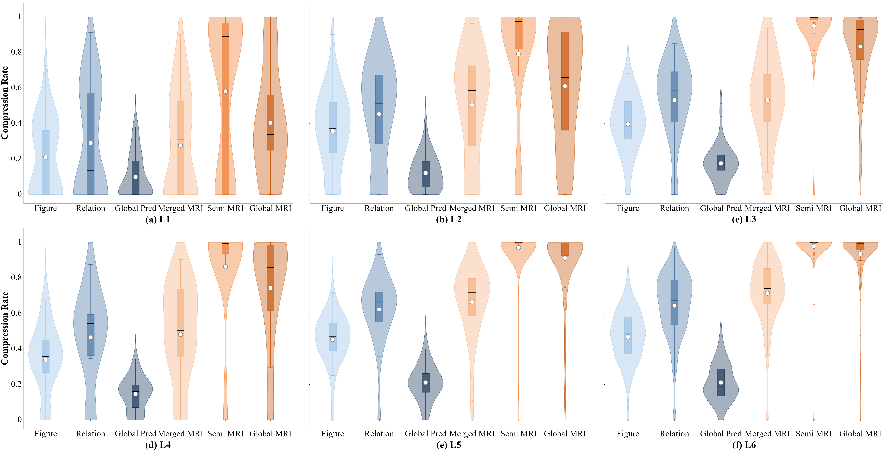

# ZGeoInference (KM-SCR)

<div align="center">

**An Efficient Geometry Automated Reasoning System Based on Deductive Databases**

[中文文档 / Chinese](README.zh-CN.md)

</div>

---

## Introduction

Rule-based deductive databases perform logical derivation by combining the known conditions of geometric propositions with inference rules such as axioms and theorems, offering rigorous logical reliability and strong knowledge discovery capabilities in automated geometry reasoning. However, when handling complex geometric problems, the inference search space expands exponentially with problem scale, causing a severe efficiency bottleneck. To address the redundancy in geometric knowledge representation and the over-rigidity of rule matching, this work tackles the problem from the dual perspective of knowledge and rule representation:

- **Geometry Object Merging** — uniformly models semantically equivalent or reducible geometric objects and their topological relations, eliminating redundant representations and compressing the inference space.
- **Chain-Equality Representation** — reduces the number of equality relations, accelerating the solving of algebraic equation systems during inference.
- **Semi-Conditional Rules** — decouples rule triggering conditions into preconditions and constraints, with step-by-step matching that drastically reduces the number of matches and overcomes combinatorial explosion.

Based on this method, the **KM-SCR** geometry theorem reasoning system achieves **98.29%** solving accuracy on the FormalGeo7k-L6 benchmark with an average inference time of **4.06 seconds**, significantly outperforming existing methods.

## Core Mechanisms

| Mechanism | Description |
| --- | --- |
| Geometry Object Merging | Unify semantically equivalent/reducible objects to eliminate redundancy and compress the inference space. |
| Chain-Equality Representation | Reduce the number of equality relations and accelerate algebraic equation solving. |
| Semi-Conditional Rules | Decouple triggering conditions and match step-by-step to reduce matches and avoid combinatorial explosion. |

The figure below shows the compression/reduction effect of **rule instantiation** and **knowledge instantiation** in this method.



## Experimental Results

| Metric | Value |
| --- | --- |
| Solving Accuracy | **98.29%** |
| Average Inference Time | **4.06 s** |

## Environment Requirements

- **.NET 10** (target framework `net10.0`)
- **Maple 2024** (the system invokes the Maple kernel via `maplec.dll` for algebraic solving; install Maple 2024 and configure the runtime environment)
- Windows OS

## Adjusting Parallel Thread Count

The inference process supports multi-threaded parallel execution. You can control how many inference tasks run simultaneously by setting the maximum concurrency. The default maximum concurrency is `5`.

Set it via the `MaxThreads` property in `GeoInference.Tests/Program.cs`:

```csharp
IntegratedTester tester = new IntegratedTester();
// Adjust the number of concurrent threads according to machine performance
tester.MaxThreads = 5;
await tester.Test();
```

Since inference involves algebraic solving and other compute-intensive tasks, **increasing the thread count does not necessarily improve overall inference speed**. With too many concurrent threads, multiple inference tasks may contend for CPU, memory, and Maple compute resources, which increases the runtime of individual tasks and may even cause calculation errors (e.g., returning a time string instead of a result).

Therefore, choose a concurrency level that matches your actual hardware; on some machines, **a lower `MaxThreads` yields more stable and faster inference**.

## Running Tests by Batch and Performance Recommendations

The test program supports running individual batches separately. Although batches are executed sequentially using `await`, running multiple batches consecutively may still affect test performance. In practice, running a single batch often yields better performance. It is therefore recommended to select individual batches according to testing requirements. For example:

```csharp
await tester.RunBatchAsync(GeoProblemDataset.FormalGeo7KL6, Exculed, nameof(GeoInferenceConfigs.Solving), maxConcurrency: MaxThreads);
```
## Build & Run

Running the system in the **Release** configuration is recommended, to avoid the extra runtime overhead of Debug mode and to obtain more stable inference performance.

```bash
# Build in Release mode
dotnet build GeoInference.slnx -c Release

# Run the integrated test in Release mode (batch inference on FormalGeo7k-L6)
dotnet run --project GeoInference.Tests -c Release
```

Before running, adjust `MaxThreads` in `GeoInference.Tests/Program.cs` according to machine performance. For example:

```csharp
IntegratedTester tester = new IntegratedTester();
tester.MaxThreads = 3;
await tester.Test();
```

The system automatically locates the `Datasets/FormalGeo7KL6` dataset and writes the inference results to the `Result/` directory, including inference JSON files, Excel reports, and related charts.

> **Recommendation:** For inference performance and result stability, run in the Release configuration and lower the concurrency according to your actual hardware. Too many threads may slow down inference or cause errors due to contention for compute resources.

## Project Structure

```
GeoInference/
├── GeoInference/               # Core inference engine (.NET 10 executable)
├── GeoInference.Tests/         # Batch testing and result report generation
├── Datasets/
│   └── FormalGeo7KL6/          # FormalGeo7k-L6 benchmark dataset
├── Result/                     # Inference results, reports and charts
├── GeoInference.slnx           # Solution file
├── README.md                   # English documentation
└── README.zh-CN.md             # Chinese documentation
```
